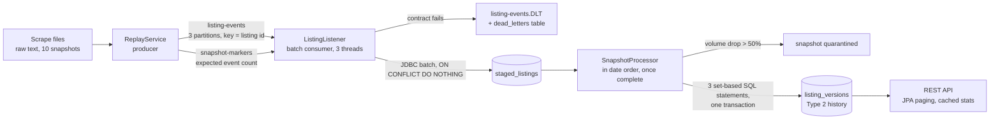

# ListingStream

**Real-time compliance tracking for New York City short-term rentals: Kafka -> Spring Boot -> PostgreSQL.**

NYC's Local Law 18 requires short-term rentals (under 30 nights) to be registered with the city. This service
streams every listing from 10 Inside Airbnb scrapes of New York City (284,472 events), validates each one,
assigns its compliance status, and keeps a full Type 2 change history of every listing in PostgreSQL.

The same raw files were already processed by a batch warehouse
([AirbnbWarehouse](https://github.com/Nezz23/airbnb-analytics-warehouse), dbt + DuckDB). The stream reproduces it
**exactly: 14 of 14 reconciliation checks**, including 56,657 history versions for 41,760 listings and every
per-snapshot compliance count ([report](docs/reconciliation.md)).

## Results

| | |
|---|---|
| End to end, 284,472 events: publish, consume, validate, store, merge history | **~1.8 s (~158,000 events/s)** on one laptop ([benchmarks](docs/benchmarks.md)) |
| Reconciliation with the batch warehouse | **14 / 14 checks identical** |
| Partial scrape (4,506 rows after 28,994) | **Quarantined** by the same volume rule as the batch pipeline |
| Full dataset replayed a second time | **284,472 duplicates skipped, 0 rows changed** |
| Tests | **19** (13 unit, 6 integration on embedded Kafka + PostgreSQL), 89% line coverage |

Unregistered short-term listings in the stream's output: 367 in June 2026, 794 by November (+116%).

## How it works



1. **Produce.** Each scrape is replayed as if it were arriving live: one event per listing (raw text, keyed by
   listing id across 3 partitions), then a marker with the scrape's event count. Every send is checked; a failed
   send fails the replay instead of losing data silently.
2. **Validate.** A per-event contract rejects what cannot be used (no snapshot date, no numeric listing id) and
   follows the warehouse's `TRY_CAST` rules for the rest, so stream and batch type the same values the same way.
   Rejected events go to a dead-letter topic with the reason in a header, and to a `dead_letters` table.
3. **Stage, idempotently.** Valid events are written in JDBC batches with `ON CONFLICT DO NOTHING` on
   (snapshot, listing). Offsets are committed only after the write, so a crash means redelivery and redelivery
   is a no-op.
4. **Decide each snapshot in order.** Events and markers travel on different topics, so either can arrive first.
   A snapshot is decided only when staged + dead-lettered events reach its marker count, and only after every
   earlier snapshot. A PostgreSQL advisory lock serializes decisions across instances.
5. **Quarantine or merge.** A scrape with under half the rows of the last good one is quarantined with the reason.
   Otherwise three set-based statements update the history in one transaction: close versions whose tracked
   attributes changed (`IS DISTINCT FROM`, so nulls compare correctly), close listings that disappeared, and open
   versions for new, changed and returning listings.

## API

| Method | Path | Purpose |
|---|---|---|
| POST | `/api/replay` | Stream the scrape files into Kafka (runs on a virtual thread) |
| GET | `/api/replay` | Replay progress |
| GET | `/api/snapshots` | Per scrape: status, reason, events expected/staged/dead-lettered, versions opened/closed, merge time |
| GET | `/api/compliance?snapshot=2026-11-01&borough=Manhattan` | Listings per Local Law 18 status (Caffeine-cached, evicted on each merge) |
| GET | `/api/compliance/trend` | Unregistered short-term listings and short-term share per scrape |
| GET | `/api/listings?borough=&status=&page=&size=` | Current listings, paged (Spring Data JPA, partial index) |
| GET | `/api/listings/{id}/history` | Every version of one listing |
| GET | `/api/dead-letters` | Latest refused events and why |
| GET | `/api/reconciliation` | Stream vs. batch warehouse, check by check |
| GET | `/actuator/metrics/listingstream.events` | Events staged, duplicate and dead-lettered (Micrometer) |

## Run it

**Docker** (Kafka in KRaft mode, PostgreSQL, the service):

```bash
../AirbnbWarehouse/.venv/bin/python scripts/export_from_warehouse.py ../AirbnbWarehouse/data/warehouse.duckdb
docker compose up --build
curl -X POST localhost:8080/api/replay
curl localhost:8080/api/reconciliation
```

**Local** (Java 21, Maven, Kafka on `localhost:9092`, PostgreSQL): `createdb listingstream && mvn spring-boot:run`.

## Tests

`mvn verify` (embedded Kafka broker in the JVM, real PostgreSQL):

- **Contract (13 unit tests):** typing that mirrors `TRY_CAST`, license normalization, every Local Law 18 branch,
  refusals that keep the claimed snapshot so the event still counts toward completion.
- **Pipeline (4 integration tests):** a listing that changes, one that disappears and returns, a partial scrape
  quarantined with the exact reason; dead-lettered events reaching both the DLT topic and the table while the
  snapshot still completes; the same snapshot delivered three times producing one result; API paging, filtering
  and errors.
- **Replay (1 integration test):** the producer on a committed sample (the first 50 real listings of two scrapes):
  every event published, staged and both snapshots decided.
- **Full reconciliation (1 integration test):** all 284,472 real events through the embedded broker, every check
  against the batch warehouse. Needs the exported scrape files (14 MB, not committed), so CI skips it.

GitHub Actions runs the suite against a PostgreSQL 17 service container (88.9% line coverage without the full
dataset), publishes the coverage report, validates the compose
file and builds the image.

## Tech

Java 21 · Spring Boot 4.2 · Spring for Apache Kafka · Apache Kafka 4.4 (KRaft) · Spring Data JPA (Hibernate) ·
JDBC batching · Flyway · PostgreSQL 17 · Caffeine cache · Micrometer · Maven · JUnit 5 · AssertJ · JaCoCo ·
Docker · GitHub Actions

Data: [Inside Airbnb](https://insideairbnb.com/get-the-data/), New York City, March to November 2026.
