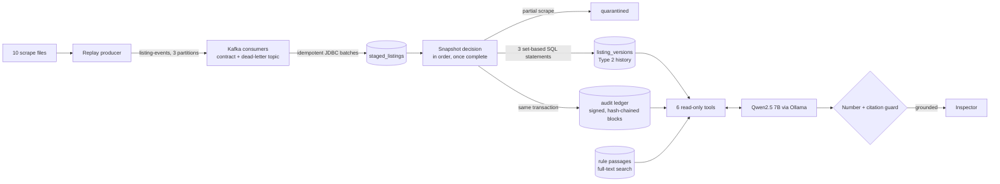

# RentGuard

**Real-time compliance monitoring for New York City short-term rentals, with a tamper-evident audit trail and an AI
assistant that is not allowed to make up numbers.** Java 21 · Spring Boot · Kafka · PostgreSQL · local LLM.

NYC's Local Law 18 requires short-term rentals (under 30 nights) to be registered with the city. RentGuard streams
every listing from 10 Inside Airbnb scrapes of New York City (284,472 events) through Kafka, flags the listings that
break the rule, records every decision in a signed, hash-chained ledger, and answers inspectors' questions in plain
English using only verified data.

**Live demo: [nezz23.github.io/rentguard](https://nezz23.github.io/rentguard/)**: verify real ledger receipts in your
browser (then edit one and watch it fail), and read every recorded assistant answer with its tool trail.

| | |
|---|---|
| **Stream** | 284,472 events in about 3 s on one laptop (~95,000 events/s), and the result matches the batch dbt warehouse on **14 of 14** checks ([reconciliation](docs/reconciliation.md)) |
| **Audit ledger** | 10 signed blocks, **58,232** recorded decisions; re-verifying every hash, Merkle root, link and signature takes ~105 ms; editing one row in PostgreSQL is caught and named |
| **AI assistant** | **23 / 23** on a SQL-checked question set, **0 wrong answers released**, 3 wrong first drafts caught and corrected by the guard ([evaluation](docs/ai-eval.md)) |
| **Tests** | 49 (41 unit, 8 integration on embedded Kafka + real PostgreSQL), **91% line coverage** in GitHub Actions |

What the data shows: unregistered short-term listings went from 367 in June 2026 to 794 in November (+116%), while
one scrape (June 8, 4,506 rows after 28,994) was quarantined as partial instead of being counted.

## How it works



### 1. Streaming pipeline (Kafka -> Spring Boot -> PostgreSQL)

- **Produce.** Each scrape is replayed as if arriving live: one event per listing, keyed by listing id across 3
  partitions, then a marker with the scrape's event count.
- **Validate.** A per-event contract types every field the same way the dbt warehouse does (`TRY_CAST` semantics)
  and assigns the Local Law 18 status. Events it refuses go to a dead-letter topic with the reason.
- **Stage idempotently.** JDBC batches with `ON CONFLICT DO NOTHING`; offsets commit only after the write. Kafka
  delivers at least once, so replaying the whole dataset again changes 0 rows.
- **Decide in order.** A snapshot is decided only once all its events have arrived and every earlier snapshot is
  decided; a PostgreSQL advisory lock serializes decisions across instances. A scrape with under half the rows of
  the last good one is quarantined; otherwise three set-based statements update the Type 2 history.

### 2. Tamper-evident audit ledger (blockchain basics, for a real reason)

A regulator, a host or a court may later ask: *what did the system say about this listing, and when, and has that
record been changed since?* The ledger answers that without asking anyone to trust the database.

- Every snapshot decision becomes **one block**: an entry for the decision plus one for every listing whose status
  changed (new, delisted, registered, went long-term...). Unchanged listings are not repeated.
- Entries are hashed (SHA-256) into a **Merkle root**; the block header holds the root and the **previous block's
  hash**, and the header hash is **signed with ECDSA P-256**. The block is written in the same database
  transaction as the decision, so a decision can never exist without its block.
- `GET /api/ledger/verify` re-derives everything from the stored rows and names the first bad block. Change one
  status in `audit_entries` and it reports the block and listing; also recompute that entry's hash and it reports
  the Merkle root instead. Forging a block needs the private key.
- `GET /api/ledger/listings/{id}` returns **receipts**: the entry, its Merkle path and the signed header. Anyone
  with the public key can check a receipt without database access; signatures use the fixed-length encoding that
  browsers' WebCrypto verifies directly.

There is no mining or token: one trusted writer signs, and everyone else can check. That is the part of a
blockchain an audit trail needs.

### 3. AI inspector assistant (tool calling + retrieval + a guard)

Ask "Which hosts have the most unregistered listings in Manhattan?" or "Is an unregistered flag proof of an illegal
booking?" and RentGuard answers with a local open model (**Qwen2.5 7B through Ollama**: free, no API key, no data
leaves the machine).

- **Tool calling, no free-form SQL.** The model can only call six fixed, parameterized, read-only queries
  (compliance counts, top hosts, listing history, trend, snapshot decisions, rule search). Every argument is
  validated; `Manhattan' or 1=1 --` is rejected as an unknown borough.
- **Retrieval (RAG).** Nine plain-language rule passages are ranked with PostgreSQL full-text search and cited as
  `[R2]`, `[R5]`...
- **The guard.** An answer is released only if **every number in it appears in a tool result** and **every
  citation is a passage the model actually retrieved**. Otherwise the model is told exactly what was wrong and gets
  one retry; after that RentGuard declines rather than guess. Each answer returns its full tool trail.
- **Evaluated, not eyeballed.** 23 questions whose answers are computed independently with SQL, including
  refusals (names, phone numbers, addresses, forecasts, "ignore your rules"). The eval found a real weakness a
  number check cannot see (a correct date attached to the wrong status) and drove the fix; see
  [docs/ai-eval.md](docs/ai-eval.md).

## API

| Method | Path | Purpose |
|---|---|---|
| POST | `/api/ask` | `{"question": "..."}` -> answer, grounded flag, tool trail, timing |
| GET | `/api/ledger/verify` | Re-verify the whole ledger; first invalid block and reason |
| GET | `/api/ledger/blocks` | Every block with its decision |
| GET | `/api/ledger/listings/{id}` | Signed receipts with Merkle proofs for one listing |
| GET | `/api/ledger/public-key` | ECDSA P-256 public key (SPKI, base64) |
| POST / GET | `/api/replay` | Stream the scrape files into Kafka / progress |
| GET | `/api/snapshots` | Per scrape: decision, reason, counts, merge time |
| GET | `/api/compliance?snapshot=&borough=` | Listings per status (Caffeine-cached, evicted on each merge) |
| GET | `/api/compliance/trend` | Unregistered short-term listings per scrape |
| GET | `/api/listings?borough=&status=&page=&size=` | Current listings, paged (Spring Data JPA) |
| GET | `/api/listings/{id}/history` | Every version of one listing |
| GET | `/api/dead-letters` | Latest refused events and why |
| GET | `/api/reconciliation` | Stream vs. batch warehouse, check by check |

Errors are RFC 9457 problem details.

## Run it

Needs Java 21, Maven, Kafka on `localhost:9092`, PostgreSQL, and for the assistant
[Ollama](https://ollama.com) with `ollama pull qwen2.5:7b`.

```bash
../AirbnbWarehouse/.venv/bin/python scripts/export_from_warehouse.py ../AirbnbWarehouse/data/warehouse.duckdb
createdb rentguard && mvn spring-boot:run
curl -X POST localhost:8080/api/replay
curl localhost:8080/api/ledger/verify
curl -X POST localhost:8080/api/ask -H 'content-type: application/json' \
     -d '{"question":"How many unregistered short-term listings are in Brooklyn right now?"}'
```

Or `docker compose up --build` for Kafka (KRaft), PostgreSQL and the service; the assistant uses Ollama on the host.

## Tests

`mvn verify` runs against an embedded Kafka broker and a real PostgreSQL database.

- **Unit (41):** the event contract; Merkle proofs for 1 to 1,000 leaves; ECDSA keys, signature encoding and
  canonical hashing; the number and citation guard; tool argument validation (including injection attempts); the
  agent loop with a scripted model (corrections, refusals, bad tool arguments, the tool budget); the Ollama wire
  format against a fake server.
- **Integration (8):** listings that change, disappear and return; a partial scrape quarantined; dead letters;
  three deliveries of the same snapshot producing one result; the ledger built, verified, receipts checked with only
  the public key, then tampered with in PostgreSQL and caught; every assistant tool against the database; the
  producer on real sample data. Two more need local resources and are skipped in CI: the full 284,472-event
  reconciliation (14 MB of scrape files) and the AI evaluation (Ollama).

GitHub Actions runs the suite against PostgreSQL 17, reports coverage, validates the compose file and builds the
Docker image.

## Limits

- Rule passages are summaries written for this project, not legal text or advice.
- `unregistered_short_term` is a screening flag from listing settings, not proof that an illegal stay happened.
- The AI score is on the question set used during development, not a held-out benchmark.
- The ledger has one signer; anyone can verify, but the key holder could rewrite history from scratch. Publishing
  the tip hash somewhere public (or co-signing) would close that.

## Tech

Java 21 · Spring Boot 4.2 (Web MVC, Data JPA, Validation, Cache, Actuator) · Spring for Apache Kafka · Apache Kafka
4.4 (KRaft) · PostgreSQL 17 (full-text search, advisory locks) · Hibernate · Flyway · JDBC batching · Caffeine ·
Micrometer · SHA-256 · Merkle trees · ECDSA P-256 · Ollama · Qwen2.5 7B · tool calling · RAG · Maven · JUnit 5 ·
Mockito · AssertJ · JaCoCo · Docker · GitHub Actions

Data: [Inside Airbnb](https://insideairbnb.com/get-the-data/), New York City, March to November 2026.
